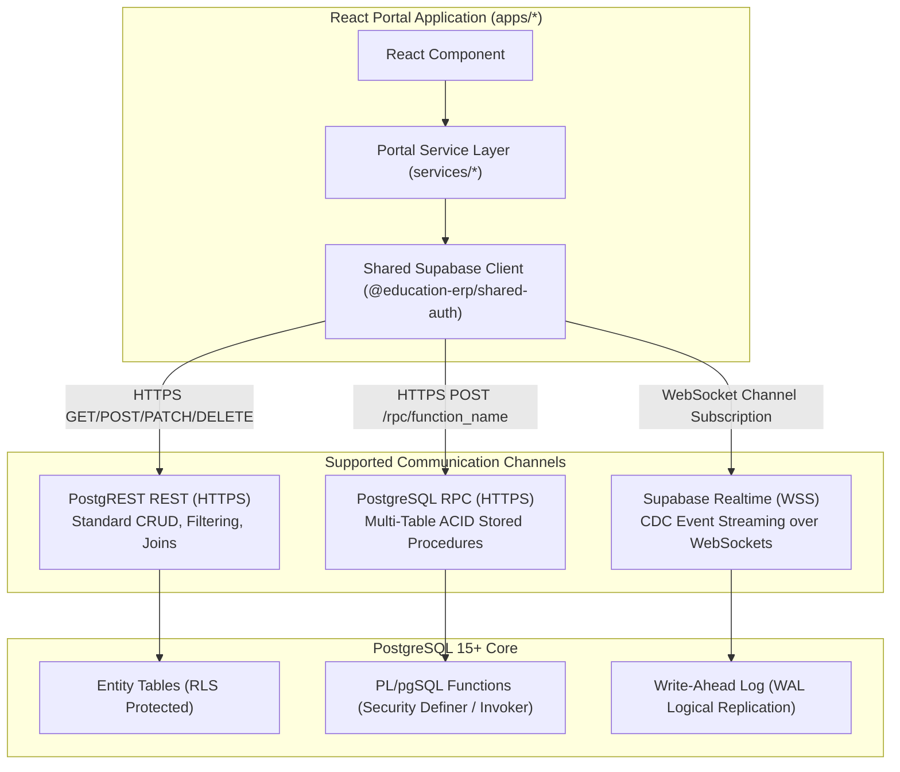
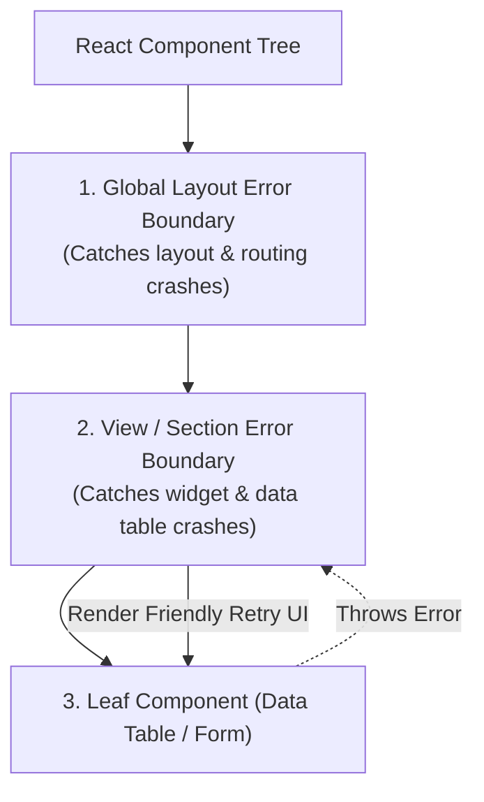

# API Architecture: Communication Patterns, Protocols & Error Handling

## 1. API Architecture Overview

The API architecture establishes a unified, predictable communication contract between the five React frontend portals and the Supabase backend.

It standardizes:
1. **Query Protocols**: Declarative PostgREST REST APIs, WebSocket Realtime channels, and transactional PostgreSQL RPC functions.
2. **Client Abstraction Layer**: Standardized portal `services/` modules that encapsulate Supabase queries.
3. **Response Envelope**: Consistent `{ data, error }` result tuples.
4. **Resilient Error Boundaries**: Preventing application crashes during network or server disruptions.

---

## 2. Communication Protocols & Protocol Mapping



---

## 3. Protocol Selection Matrix

| Operation Category | Protocol | Endpoint Pattern | Example |
| :--- | :--- | :--- | :--- |
| **Entity Fetching & Lookups** | PostgREST (REST) | `GET /rest/v1/<table_name>` | Fetching active student directory, group schedules, courses. |
| **Simple Entity Mutation** | PostgREST (REST) | `POST / PATCH / DELETE /rest/v1/<table_name>` | Updating user avatar, creating an inbound CRM lead, updating room name. |
| **Atomic Multi-Table Transactions** | PostgreSQL RPC | `POST /rest/v1/rpc/<func_name>` | `process_tuition_payment`, `enroll_student_in_cohort`, `close_lesson_journal`. |
| **Realtime Live Updates** | WebSockets (WSS) | `wss://<id>.supabase.co/realtime/v1/websocket` | Live classroom attendance marking, tuition status changes, broadcast notices. |
| **Binary File Transfer** | Storage API | `GET / POST /storage/v1/object/<bucket>` | Uploading and streaming tuition invoice PDFs, student avatars. |

---

## 4. Standardized Response Tuple Standard

To ensure clean error propagation and eliminate unhandled promise rejections, all portal services must return a standardized tuple:

```javascript
/**
 * @typedef {Object} ServiceResult
 * @property {any} data - The query payload on success, or null on error
 * @property {string|null} error - User-friendly error message on failure, or null on success
 */
```

### Pattern Implementation:

```javascript
// services/attendanceService.js
import { getSupabaseClient } from '@education-erp/shared-auth';
import { formatErrorMessage, AppError } from '@education-erp/shared-utils';

export const attendanceService = {
  async getLessonAttendance(lessonId) {
    try {
      const client = getSupabaseClient();
      const { data, error } = await client
        .from('attendance')
        .select(`
          id,
          student_id,
          status,
          notes,
          student:profiles ( first_name, last_name )
        `)
        .eq('lesson_id', lessonId);

      if (error) {
        return { data: null, error: formatErrorMessage(error) };
      }

      return { data, error: null };
    } catch (err) {
      return { data: null, error: formatErrorMessage(err) };
    }
  }
};
```

---

## 5. Global & Portal-Level Error Boundaries

To prevent React application white-screen crashes when unexpected errors or network failures occur:



### Error Recovery Rules:
1. **Network Interruptions**: The service layer identifies network failures via `isNetworkError(err)` and presents a "Connection lost. Reconnecting..." indicator with automatic retry.
2. **Permission Denials (RLS Violation)**: Handled gracefully by returning an "Action not permitted by institutional policy" error rather than breaking the application.
3. **Session Expiry**: When a 401 Unauthorized status is returned, the client automatically attempts a silent token refresh via `client.auth.refreshSession()`. If the refresh fails, the user is redirected to the login view.
