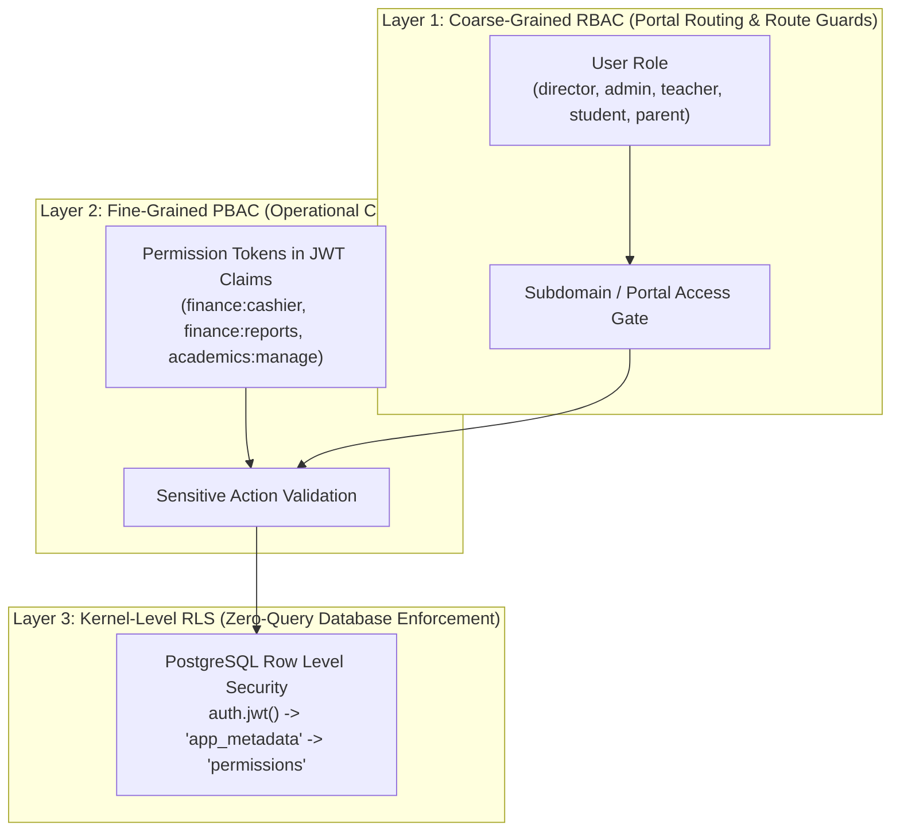
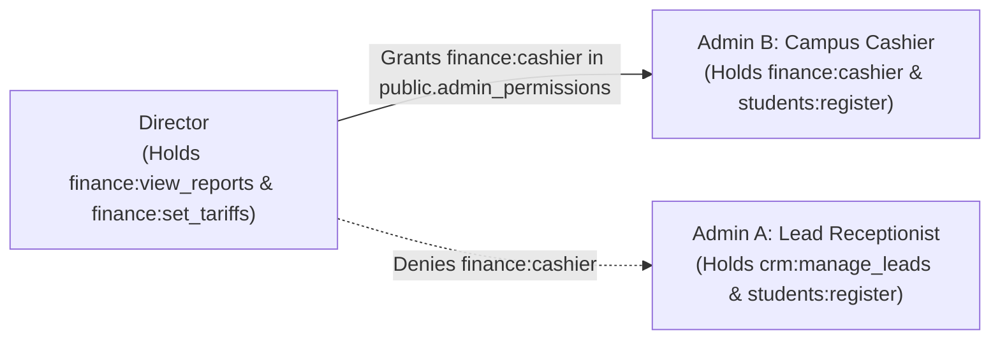

# Authorization Architecture: Hybrid RBAC + PBAC Model

## 1. Architectural Strategy

The Education Center ERP + CRM implements a **Hybrid RBAC + PBAC (Role-Based + Permission-Based Access Control)** model.

This dual-layer authorization pattern resolves a key challenge: coarse-grained roles determine portal navigation, while fine-grained permissions govern sensitive operational actions (especially financial cashiering) without requiring an independent Accountant portal.



---

## 2. Distinction Between Roles and Permissions

| Concept | Purpose | Where Evaluated | Example |
| :--- | :--- | :--- | :--- |
| **Role (RBAC)** | Coarse-grained category determining which portal application the user belongs to and general menu views. | Frontend Route Guards & Subdomain Redirection | `director`, `admin`, `teacher`, `student`, `parent` |
| **Permission (PBAC)** | Granular authorization tokens granting specific operational capabilities, particularly within the Admin and Director scopes. | Frontend UI Actions & PostgreSQL RLS Policies | `finance:cashier`, `finance:reports`, `manage:admins`, `attendance:record` |

---

## 3. Five Authoritative System Roles

1. **`director`**: Top-level executive authority over the institution. Authorized for `director.example.uz` and `admin.example.uz`.
2. **`admin`**: Campus operations manager. Authorized for `admin.example.uz`.
3. **`teacher`**: Instructional faculty. Authorized for `teacher.example.uz`.
4. **`student`**: Enrolled learner. Authorized for `student.example.uz`.
5. **`parent`**: Parent / legal guardian. Authorized for `parent.example.uz`.

*Strict Scope Rule*: There is **NO** `accountant` role and **NO** `hr` role in the system.

---

## 4. Fine-Grained Permission Tokens

Permission tokens are string identifiers structured as `domain:action`:

### 4.1 Institutional Governance & Admin Management
- `institution:manage_settings`: Modify campus parameters, working hours, and policies.
- `institution:manage_branches`: Create and configure campus branches.
- `admin:provision`: Create and edit administrator accounts (Director only).
- `audit:view`: Inspect system audit logs (Director only).

### 4.2 Financial Operations (Configurable for Director & Admin)
- `finance:view_reports`: Inspect consolidated revenue summaries, accounts receivable, and cash flow.
- `finance:cashier`: Record student payments (cash, card, bank transfer), issue receipts, and cancel unpaid invoices.
- `finance:set_tariffs`: Create and modify course pricing tariffs and discount rates.

### 4.3 Academic Operations & CRM
- `crm:manage_leads`: Record inbound inquiries, schedule trial lessons, update funnel status.
- `academics:manage_courses`: Create and update course catalog items.
- `academics:manage_groups`: Form cohorts, assign classrooms, and configure weekly timetable.
- `academics:assign_teachers`: Assign instructors to course cohorts.
- `students:register`: Enroll new students and create parent linkages.

### 4.4 Instructional & Family
- `attendance:record`: Mark student presence/absence in lessons (Teacher full, Admin override).
- `grades:submit`: Enter homework scores and exam results (Teacher only).
- `learning:view_own`: View own progress (Student only).
- `family:view_children`: View linked children's records (Parent only).

---

## 5. Configurable Admin Financial Permissions (Eliminating the Accountant Role)

A central requirement of the system is that **finance is handled directly inside the Director and Admin portals without an external Accountant**:



- When Director provisions an Administrator, they can toggle the `finance:cashier` and `finance:view_reports` permissions in `public.admin_permissions`.
- A database trigger synchronizes assigned permissions directly into the user's JWT `app_metadata.permissions` array.
- In PostgreSQL, the `payments` and `invoices` tables check the claims directly in memory with **zero database subqueries**:
  ```sql
  CREATE POLICY admin_insert_payment ON public.payments
  FOR INSERT
  WITH CHECK (
    -- Direct in-memory JSONB claim evaluation: sub-microsecond performance
    (auth.jwt() -> 'app_metadata' -> 'permissions')::jsonb ? 'finance:cashier'
    OR
    (auth.jwt() -> 'app_metadata' ->> 'role') = 'director'
  );
  ```
- If an admin lacks `finance:cashier`, the Cashier tab in the Admin Portal is hidden in the UI, and any direct API write is rejected by PostgreSQL kernel-level RLS.

---

## 6. Multi-Level Authorization Enforcement

1. **Level 1 (DNS & Subdomain)**: Users are directed to their dedicated portal subdomain.
2. **Level 2 (Client Route Guards)**: React Router layout components check `user.role` from `AuthContext`. If unauthorized, the user is redirected to their own portal.
3. **Level 3 (UI Capability Triggers)**: Action buttons (e.g., "Record Payment") are disabled or hidden based on `hasPermission(role, permission)`.
4. **Level 4 (PostgreSQL Row Level Security - Final Authority)**: Every query, insert, update, and delete is verified against database policies before execution.
