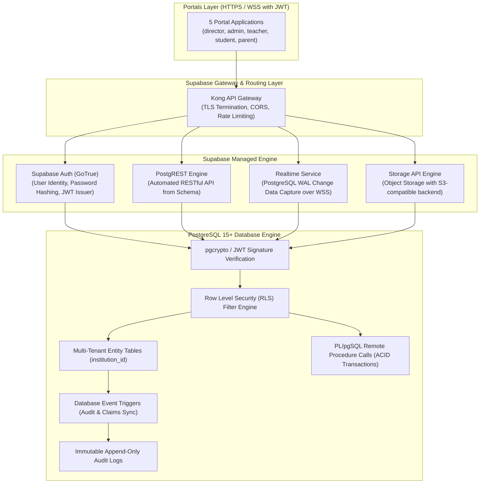

# Backend Architecture: Unified Supabase & PostgreSQL Engine

## 1. Architectural Philosophy

The Education Center ERP + CRM adopts a **Unified Backend-as-a-Service (BaaS) Architecture** powered by **Supabase** and **PostgreSQL 15+**.

Instead of developing and maintaining five disparate backend microservices or custom Node.js Express/Nest servers, the platform leverages Supabase's managed engine. This delivers:
1. **Zero Microservice Sprawl**: One single database connection pool, one migration history, and one operational boundary.
2. **Instant Transactional Consistency**: Cashier payments recorded by an Administrator instantly reflect in the Director's financial reports and the Parent's payment history without distributed cache invalidation lags.
3. **Kernel-Level Authorization**: Security is executed directly inside the PostgreSQL kernel using Row Level Security (RLS), rendering bypass impossible even with manipulated frontend code.

---

## 2. Supabase Core Subsystems

---

## 3. PostgREST RESTful API Layer

Supabase exposes the PostgreSQL schema directly through PostgREST:
- Every table (`students`, `groups`, `attendance`, `invoices`) is immediately accessible via declarative REST queries.
- Filtering, sorting, and pagination are handled using standard URL query parameters (e.g., `?status=eq.active&order=last_name.asc`).
- Relational joins are performed natively via PostgREST embedded resource syntax (`.select('id, name, teacher:profiles(first_name, last_name)')`), reducing the need for custom API endpoints.

---

## 4. PostgreSQL Remote Procedure Calls (RPC) for ACID Transactions

While standard CRUD queries use PostgREST, **multi-table atomic business transactions** are implemented as PostgreSQL Stored Procedures (`PL/pgSQL functions`) executed via `supabase.rpc()`.

### Why RPC is Essential:
1. **Atomicity**: Client-side multi-query sequences (e.g., insert payment -> update invoice -> decrement debt) are vulnerable to network failures midway. An RPC function wraps all operations in a single database transaction (`BEGIN ... COMMIT`).
2. **Business Rule Enforcement**: Calculations (such as tariff discounts, multi-child family discounts, and late fees) execute on the server, preventing client-side price tampering.
3. **Audit Trail Guarantee**: RPC functions write to `public.audit_logs` inside the same transaction; if the audit write fails, the entire transaction rolls back.

### Planned Core RPC Functions:
- `process_tuition_payment(p_invoice_id, p_amount, p_method, p_admin_id)`: Settles invoices, records payment ledger, updates student balance.
- `enroll_student_in_group(p_student_id, p_group_id, p_tariff_id)`: Verifies room capacity, creates enrollment record, generates first monthly invoice.
- `bulk_mark_attendance(p_lesson_id, p_records_json)`: Records attendance for an entire classroom cohort in a single operation.

---

## 5. Supabase Realtime Architecture

For instant, reactive UI updates, portals connect to Supabase Realtime:
- **Technology**: Elixir/Phoenix WebSocket cluster monitoring PostgreSQL's Write-Ahead Log (WAL) via logical replication.
- **Use Cases**:
  - Teacher marks attendance -> Parent portal updates attendance status badge instantly.
  - Cashier records payment -> Student portal updates tuition balance in real time.
  - Director broadcasts an emergency closure notice -> All connected portals receive the alert.
- **Security**: Realtime events respect Row Level Security policies. Users only receive CDC (Change Data Capture) messages for rows they are authorized to `SELECT`.

---

## 6. Supabase Storage Architecture

Unstructured files and media are stored in Supabase Storage:
- **Bucket Structure**:
  - `avatars`: User profile photographs (public read, authenticated update for own profile).
  - `receipts`: Generated payment receipts and billing statements (private, accessible only to Admin, Director, and the owning Student/Parent).
  - `course-materials`: Syllabi and study guides (accessible to enrolled students and assigned teachers).
- **Access Control**: Storage buckets are governed by PostgreSQL RLS policies defined on `storage.objects`.
