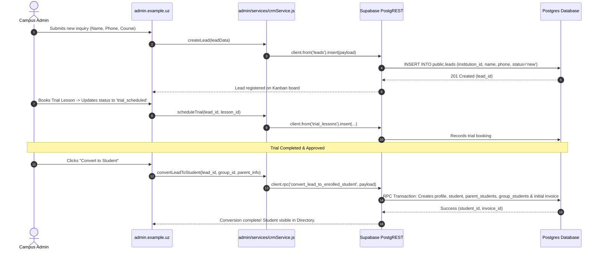
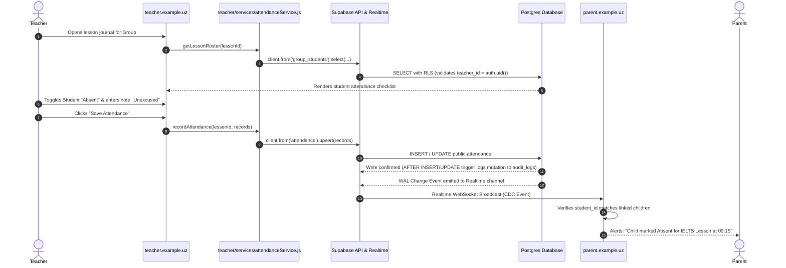
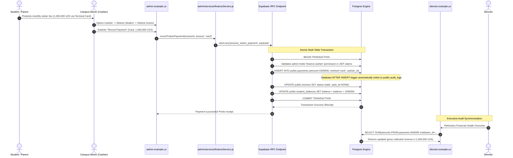
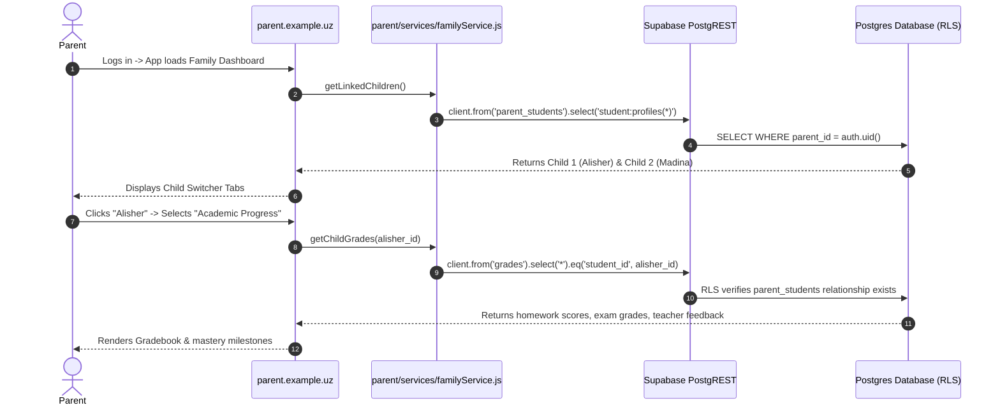

# End-to-End System Data Flows

## 1. Overview

This document maps out the core data lifecycles and sequence workflows of the Education Center ERP + CRM across portals, services, and the database.

---

## 2. Workflow 1: Inbound Lead to Student Enrollment

---

## 3. Workflow 2: Lesson Attendance Journaling & Realtime Parent Notification

---

## 4. Workflow 3: Tuition Billing & Cashier Reconciliation (No Accountant)

---

## 5. Workflow 4: Parent Multi-Child Academic & Attendance Monitoring

