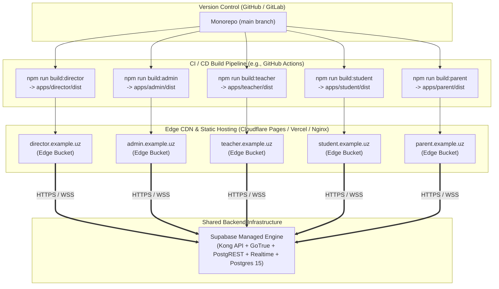

# Deployment Architecture: Multi-Subdomain Edge Strategy

## 1. Deployment Model Overview

The Education Center ERP + CRM adopts an **Independent Static Edge Deployment Architecture**.

Each of the five React + Vite portal applications is built as an independent static Single Page Application (SPA) and deployed to edge CDN nodes, communicating over HTTPS/WSS with the centralized Supabase backend:



---

## 2. Independent Build Targets & Outputs

Each portal produces an isolated production distribution:

| Application | Monorepo Path | Build Command | Output Directory | Typical Gzip Size |
| :--- | :--- | :--- | :--- | :--- |
| **Director Portal** | `apps/director` | `npm run build:director` | `apps/director/dist` | ~56.8 KB |
| **Admin Portal** | `apps/admin` | `npm run build:admin` | `apps/admin/dist` | ~56.5 KB |
| **Teacher Portal** | `apps/teacher` | `npm run build:teacher` | `apps/teacher/dist` | ~56.3 KB |
| **Student Portal** | `apps/student` | `npm run build:student` | `apps/student/dist` | ~56.3 KB |
| **Parent Portal** | `apps/parent` | `npm run build:parent` | `apps/parent/dist` | ~56.3 KB |

### Key Deployment Characteristics:
1. **Zero Downtime Deploys**: Deploying updates to the Parent Portal does not affect or restart the Admin or Teacher applications.
2. **Selective Builds**: CI/CD pipelines can detect changed paths (e.g., changes under `apps/teacher/**`) and rebuild only that specific portal.
3. **Atomic Revertibility**: If a bug is detected in a new release of `apps/admin`, it can be instantly rolled back to the prior deployment without affecting other portals.

---

## 3. Web Server & SPA Rewrite Rules

Because each portal uses React Router (`<BrowserRouter>`) for client-side routing, edge servers must route all non-file requests to `/index.html`:

### Nginx Example Configuration:
```nginx
server {
    server_name admin.example.uz;
    root /var/www/education-erp/apps/admin/dist;
    index index.html;

    location / {
        try_files $uri $uri/ /index.html;
    }

    # Static asset caching (1 year cache with immutable hashes)
    location /assets/ {
        expires 1y;
        add_header Cache-Control "public, max-age=31536000, immutable";
    }
}
```

### Cloudflare Pages / Vercel Configuration:
- An edge rewrite rule `/* -> /index.html` is configured per project.

---

## 4. DNS & SSL Certificate Strategy

- **DNS Records**:
  - A Wildcard `CNAME` or `A` record `*.example.uz` points to the edge CDN proxy cluster.
- **TLS/SSL Encryption**:
  - A Wildcard SSL Certificate covering `example.uz` and `*.example.uz` is provisioned.
  - Enforces TLS 1.3 with automated renewal via Let's Encrypt / Cloudflare Edge Certificates.
- **Cross-Subdomain Cookie Compatibility**:
  - The wildcard certificate ensures all five subdomains share a trusted HTTPS origin, permitting the parent-domain session cookie (`Domain=.example.uz; Secure`) to be transmitted securely.
