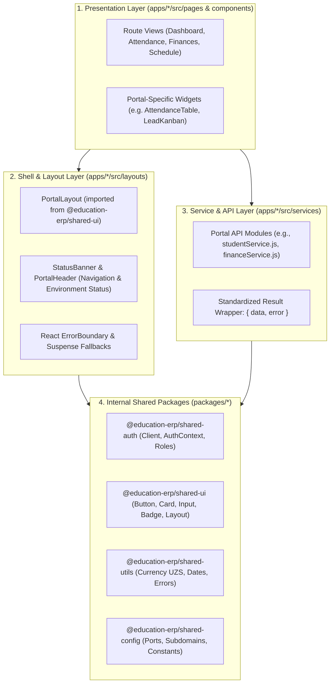

# Frontend Architecture: Five Independent React Applications

## 1. Architectural Overview

The frontend layer consists of **five independent Single Page Applications (SPAs)** built using **React 18+**, **Vite 6+**, and modern **JavaScript (ES Modules)**, managed within an npm Workspaces monorepo.

Each application is a completely autonomous project residing in `apps/<portal-name>` with its own:
- `package.json` (declaring application-specific metadata and scripts)
- `vite.config.js` (defining port allocations, build targets, and React plugins)
- `index.html` (tailored title, meta tags, and root entry point)
- `src/main.jsx` (independent React 18 `createRoot` mounting point)
- `src/routes/index.jsx` (dedicated React Router DOM v6 route hierarchy)

---

## 2. Component Hierarchy & Layering

Each portal application strictly adheres to a layered architecture:



---

## 3. Internal Application Structure

All five applications maintain a strictly standardized directory layout:

```text
apps/<portal>/
├── public/                       # Static public assets (favicon, logos)
├── src/
│   ├── assets/                   # Portal-specific static assets
│   ├── components/               # Portal-specific UI components
│   ├── config/                   # Navigation configuration & portal metadata
│   ├── hooks/                    # Portal-specific React hooks (useAttendance, useLeads)
│   ├── layouts/                  # PortalLayout container wrapping AppRoutes
│   ├── pages/                    # Routed page components
│   ├── routes/                   # React Router route tree (index.jsx)
│   ├── services/                 # API service layer calling Supabase
│   ├── utils/                    # Portal-specific utility functions
│   └── main.jsx                  # Application entry point
├── index.html                    # HTML template
├── package.json                  # Application package manifest
├── postcss.config.js             # Tailwind CSS & Autoprefixer plugin config
├── tailwind.config.js            # Tailwind configuration inheriting shared preset
└── vite.config.js                # Vite build and dev server configuration
```

---

## 4. State Management Strategy

To prevent unnecessary complexity and heavy runtime dependencies (e.g., Redux, MobX), state management follows a three-tier model:

1. **Authentication & Session State (Global Context)**:
   - Handled via `AuthContext` exported from `@education-erp/shared-auth`.
   - Stores current user identity, active role, permissions, and session token.
   - Initialized at application root mount in `main.jsx`.
2. **Server Cache & Query State (Service Layer Hooks)**:
   - Encapsulated within custom React hooks (`useAsyncData`, `useAttendanceRoster`).
   - Maintains fetch states (`data`, `isLoading`, `error`, `refetch`).
   - Emits standardized `{ data, error }` tuples matching the Supabase response convention.
3. **Local Component State (`useState`, `useReducer`)**:
   - Manages UI toggles, active tabs, modal visibility, and local form inputs.
   - Forms use controlled React state with `@education-erp/shared-utils` validation before submission.

---

## 5. API Service Layer Standard

Direct calls to `supabase.from()` are **forbidden** inside React page components. Instead, every portal implements a dedicated `services/` module:

```javascript
// Example Pattern: apps/admin/src/services/studentService.js
import { getSupabaseClient } from '@education-erp/shared-auth';
import { formatErrorMessage, AppError } from '@education-erp/shared-utils';

export const studentService = {
  /**
   * Fetches active students for the current institution
   * @param {string} branchId 
   * @returns {Promise<{ data: Array|null, error: string|null }>}
   */
  async getStudents(branchId = null) {
    try {
      const client = getSupabaseClient();
      let query = client
        .from('students')
        .select(`
          id,
          first_name,
          last_name,
          phone,
          status,
          groups ( id, name )
        `)
        .order('last_name', { ascending: true });

      if (branchId) {
        query = query.eq('branch_id', branchId);
      }

      const { data, error } = await query;
      if (error) {
        return { data: null, error: formatErrorMessage(error) };
      }

      return { data, error: null };
    } catch (err) {
      return { data: null, error: formatErrorMessage(err) };
    }
  }
};
```

### Benefits of the Service Layer:
- **Decoupling**: UI components remain completely agnostic of backend query syntax.
- **Unified Error Handling**: Catches exceptions and returns predictable error strings.
- **Mockability**: Services can be easily mocked for unit and integration testing.

---

## 6. Routing & Client Navigation Architecture

- Each portal implements React Router DOM v6 with `<BrowserRouter>`.
- Internal navigation uses `<Link>` and `<NavLink>` from `react-router-dom`, preserving SPA state without full page reloads.
- Unknown paths trigger the shared `<NotFoundView />` component exported by `@education-erp/shared-ui`.
- Cross-portal navigation (e.g., Director switching to the Admin Portal) uses explicit absolute URLs generated via `getPortalUrl('admin')` from `@education-erp/shared-config`.

---

## 7. Build & Performance Optimization

- **Zero Bundled Unused Portals**: Since each portal is an independent Vite project, code from the other four portals is never included in the bundle.
- **Production Asset Chunking**: Vite compiles code into optimized, content-hashed vendor and application chunks.
- **Gzip Compression**: Initial production bundle size for each portal is verified under **57 KB gzipped** (total uncompressed JS < 177 KB).
- **Tree-Shaking**: Tailwind CSS scans only the current portal and `@education-erp/shared-ui`, producing minimal production stylesheets (< 16 KB).
