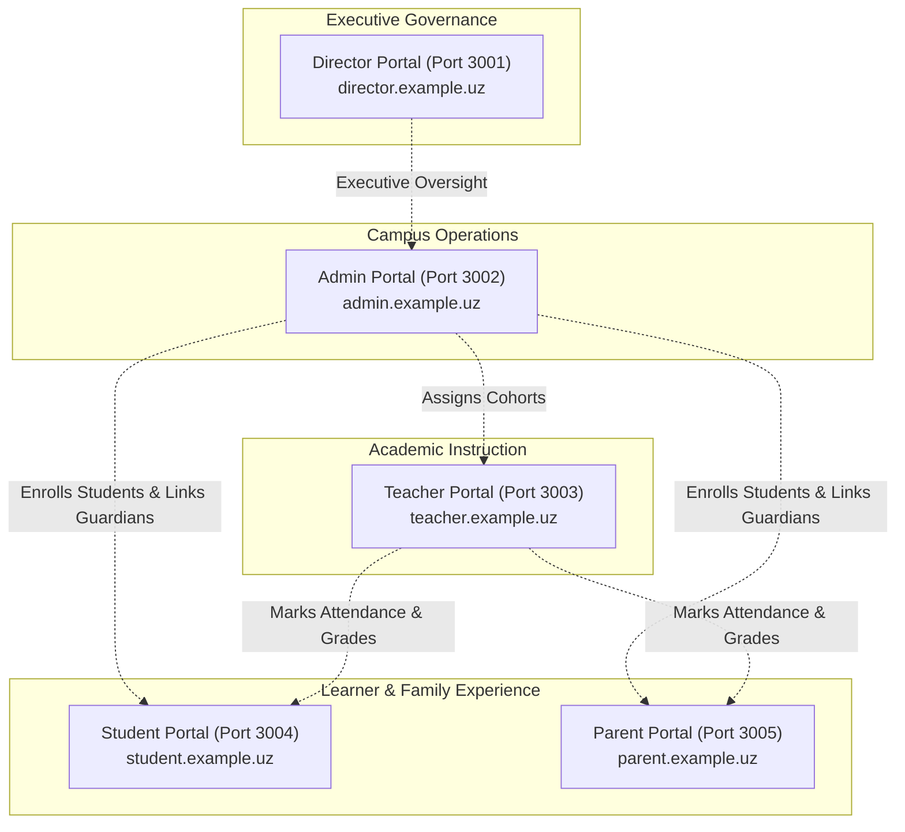

# Portal Architecture: Boundaries, Responsibilities & Isolation

## 1. Five-Portal Decomposition

The platform segments users into five discrete web applications, each serving an exclusive stakeholder persona with well-defined operational boundaries:

---

## 2. Detailed Portal Boundaries & Responsibilities

### 2.1 Director Portal (`apps/director`)
- **Primary Audience**: Center Owners, Executive Directors, Academic Directors.
- **Subdomain**: `director.example.uz` (Local Port: `3001`).
- **Core Responsibilities**:
  - Global institutional health oversight (total active enrollments, revenue trends, branch capacity).
  - Provisioning and managing campus Administrator accounts.
  - Reviewing executive financial statements (profit & loss, accounts receivable, debt aging).
  - Approving tuition fee structures, course pricing tariffs, and discount models.
  - Full institutional audit log inspection (`audit_logs`).
- **Permitted Access**:
  - Full access to institutional settings, branches, administrative users, financial reports, and high-level academic statistics.
- **Prohibited Access**:
  - Routine classroom lesson journal entries (teachers mark attendance, not directors).
  - Detailed student homework grading forms.
  - Direct student learning portals.

### 2.2 Admin Portal (`apps/admin`)
- **Primary Audience**: Campus Operations Managers, Front-Desk Administrators, Registrars, Cashiers.
- **Subdomain**: `admin.example.uz` (Local Port: `3002`).
- **Core Responsibilities**:
  - Inbound lead intake and CRM lifecycle tracking (New Inquiry -> Contacted -> Trial Scheduled -> Enrolled).
  - Student registration, identity document recording, and parent contact association.
  - Course cohort (group) formation, schedule coordination, and classroom allocation.
  - Teacher assignment to academic groups.
  - **Operational Cashiering**: Recording tuition payments (cash, terminal, transfer), issuing receipts, managing invoice balances.
- **Strict Role Restriction**:
  - **NO SEPARATE ACCOUNTANT ROLE**. All daily billing, tuition collection, and receipt issuance are conducted directly in the Admin Portal.
  - Admin cannot provision other Administrator accounts unless granted explicit delegation by the Director.
- **Prohibited Access**:
  - Executive financial profit distribution or institution-wide equity metrics.
  - Deleting audit logs or bypassing RLS financial triggers.

### 2.3 Teacher Portal (`apps/teacher`)
- **Primary Audience**: Instructional Faculty, Subject Mentors, Teaching Assistants.
- **Subdomain**: `teacher.example.uz` (Local Port: `3003`).
- **Core Responsibilities**:
  - Viewing weekly class schedules and assigned room locations.
  - Accessing student rosters for assigned groups only.
  - Recording lesson attendance flags (Present, Absent, Excused, Late).
  - Submitting assignment scores, examination grades, and student performance notes.
- **Permitted Access**:
  - Only groups where `groups.teacher_id = auth.uid()`.
  - Academic attendance and grading logs for assigned students.
- **Prohibited Access**:
  - Groups taught by other instructors.
  - Student tuition balances, invoices, or payment histories.
  - Institutional financial figures or admissions CRM pipelines.

### 2.4 Student Portal (`apps/student`)
- **Primary Audience**: Enrolled Students and Learners.
- **Subdomain**: `student.example.uz` (Local Port: `3004`).
- **Core Responsibilities**:
  - Viewing personal weekly class timetable, room numbers, and teacher profiles.
  - Reviewing personal attendance history and punctuality statistics.
  - Tracking academic progress, homework evaluations, and test results.
  - Checking tuition subscription balance, upcoming invoice due dates, and paid receipts.
  - Accessing course curriculum syllabi and study guides.
- **Permitted Access**:
  - Strictly limited to personal records where `student_id = auth.uid()`.
- **Prohibited Access**:
  - Other students' academic records, grades, or personal contact info.
  - All administrative, teaching, or cashiering interfaces.

### 2.5 Parent Portal (`apps/parent`)
- **Primary Audience**: Parents and Legal Guardians.
- **Subdomain**: `parent.example.uz` (Local Port: `3005`).
- **Core Responsibilities**:
  - Consolidated family dashboard with seamless child-switching capability.
  - Real-time lesson attendance monitoring and absence alert history.
  - Reviewing teachers' academic remarks, homework feedback, and exam grades.
  - Inspecting itemized tuition fee invoices and downloading digital payment receipts.
- **Permitted Access**:
  - Strictly limited to students linked via `public.parent_students` where `parent_id = auth.uid()`.
- **Prohibited Access**:
  - Any child not formally linked to the parent account.
  - Center operations, teacher records, or institutional financial data.

---

## 3. Comparative Access Matrix

| Feature / Resource Domain | Director | Admin | Teacher | Student | Parent |
| :--- | :---: | :---: | :---: | :---: | :---: |
| Institution Settings & Branches | **Full** | Read | None | None | None |
| Admin Account Provisioning | **Full** | Prohibited | None | None | None |
| Executive Financial Reports | **Full** | Configurable | None | None | None |
| Tuition Cashiering & Receipts | Oversight | **Full** | None | None | None |
| CRM & Inbound Lead Pipeline | Read | **Full** | None | None | None |
| Course & Group Scheduling | Read | **Full** | Read (Assigned) | None | None |
| Student Profile Management | Read | **Full** | Read (Assigned) | Own Profile | Linked Children |
| Lesson Attendance Marking | None | Override | **Full (Assigned)** | None | None |
| Student Gradebook Submission | None | Read | **Full (Assigned)** | None | None |
| View Own Attendance & Grades | None | None | None | **Full** | None |
| View Children Attendance & Grades| None | None | None | None | **Full** |
| Access Audit Logs | **Full** | Prohibited | None | None | None |
| Separate Accountant Portal | **None** | **None** | **None** | **None** | **None** |
| HR & Payroll Module | **None** | **None** | **None** | **None** | **None** |
| Marketing Automation Module | **None** | **None** | **None** | **None** | **None** |
