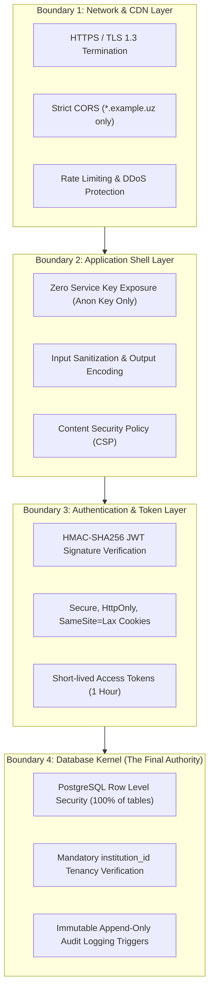

# Security Architecture: Defense-in-Depth & Data Protection

## 1. Security Philosophy: Defense-in-Depth

The Education Center ERP + CRM adopts a strict **Defense-in-Depth Security Model**.

The frontend application is treated as an untrusted, public environment. The system never relies upon client-side checks, hidden buttons, or route guards as security boundaries. Absolute security and data isolation are enforced at the database kernel level through **PostgreSQL Row Level Security (RLS)**.



---

## 2. Row Level Security (RLS) Strategy

Row Level Security is enabled on **every** table in the `public` schema. Default access is set to `DENY ALL`.

### 2.1 RLS Design Principles:
1. **Explicit Grants**: A user can only access rows where an explicit policy evaluates to `TRUE`.
2. **Context-Driven Filters**:
   - `auth.uid()`: Evaluates the authenticated user's ID.
   - `auth.jwt() -> 'app_metadata' ->> 'role'`: Reads the synchronized role token.
   - `auth.jwt() -> 'app_metadata' ->> 'institution_id'`: Guarantees tenant isolation.
3. **Write Isolation**: `WITH CHECK` clauses ensure users cannot write rows that violate their ownership boundaries (e.g., a teacher cannot assign an attendance record to another teacher's lesson).

### 2.2 Representative RLS Matrix:

```sql
-- Example 1: Multi-tenant student roster visibility
CREATE POLICY student_select_policy ON public.students
FOR SELECT
USING (
  -- Tenant matching
  institution_id = (auth.jwt() -> 'app_metadata' ->> 'institution_id')::uuid
  AND (
    -- Director & Admin see all institution students
    (auth.jwt() -> 'app_metadata' ->> 'role') IN ('director', 'admin')
    OR
    -- Teachers see students in their assigned groups
    EXISTS (
      SELECT 1 FROM public.group_students gs
      JOIN public.groups g ON g.id = gs.group_id
      WHERE gs.student_id = students.id AND g.teacher_id = auth.uid()
    )
    OR
    -- Student sees only their own profile
    students.id = auth.uid()
    OR
    -- Parent sees only their linked children
    EXISTS (
      SELECT 1 FROM public.parent_students ps
      WHERE ps.parent_id = auth.uid() AND ps.student_id = students.id
    )
  )
);
```

---

## 3. Secret Management & Environment Isolation

### 3.1 Strict Prohibition of Service Role Key
- The Supabase Service Role Key (`SUPABASE_SERVICE_ROLE_KEY`) bypasses all Row Level Security policies.
- **Strict Architecture Rule**: The Service Role Key is **NEVER** stored in `.env`, client application configs, or frontend bundles.
- Client applications exclusively use `VITE_SUPABASE_ANON_KEY`, which carries zero default privileges and strictly subjects every query to RLS policies.

### 3.2 Environment Variable Hygiene
- Only variables prefixed with `VITE_` are exposed to the browser.
- `.env` files are added to `.gitignore`.
- Production credentials are injected via secure CI/CD pipeline environment variables at build/deploy time.

---

## 4. Immutable Audit Logging Architecture

To ensure tamper-proof compliance and auditability for financial and administrative actions:

```mermaid
flowchart LR
    ClientAction["Client Action\n(e.g., Cashier Records Payment)"]
    PostgresTable["Sensitive Table\n(payments, invoices, user_roles)"]
    Trigger["PostgreSQL AFTER Trigger\n(FOR EACH ROW)"]
    AuditLog["public.audit_logs\n(Immutable Append-Only Table)"]

    ClientAction -->|INSERT / UPDATE / DELETE| PostgresTable
    PostgresTable -->|Fires| Trigger
    Trigger -->|Writes Actor, Diff, Timestamp| AuditLog
    AuditLog -.->|DENY UPDATE / DELETE (RLS)| ClientAction
```

### 4.1 Audit Log Schema (`public.audit_logs`)
- `id`: UUID (Primary Key).
- `institution_id`: UUID (Tenant ID).
- `table_name`: TEXT (Target table e.g. `payments`).
- `record_id`: UUID (ID of the modified row).
- `action`: TEXT (`INSERT`, `UPDATE`, `DELETE`).
- `actor_id`: UUID (`auth.uid()`).
- `old_data`: JSONB (Previous state, null for insert).
- `new_data`: JSONB (New state, null for delete).
- `ip_address`: INET (Client IP address).
- `created_at`: TIMESTAMPTZ (Immutable server timestamp).

### 4.2 Security Constraints on `audit_logs`:
- **NO UPDATE**: Policies prohibit `UPDATE` on `public.audit_logs` for all roles.
- **NO DELETE**: Policies prohibit `DELETE` on `public.audit_logs` for all roles (including Director).
- **SELECT**: Restricted exclusively to users with the `director` role.

---

## 5. Web Application Security Standards

- **Cross-Site Scripting (XSS)**: React natively escapes all JSX text interpolation. Input strings are sanitized via `@education-erp/shared-utils` before rendering.
- **Cross-Site Request Forgery (CSRF)**: Production authentication cookies are configured with `SameSite=Lax` and `Secure=true`.
- **SQL Injection**: Prevented natively by PostgREST and Supabase client parameterization; raw string concatenation in SQL queries is prohibited.
- **Content Security Policy (CSP)**: Headers delivered by CDN edge proxies restrict script and connect origins strictly to approved subdomains and the Supabase API domain.
