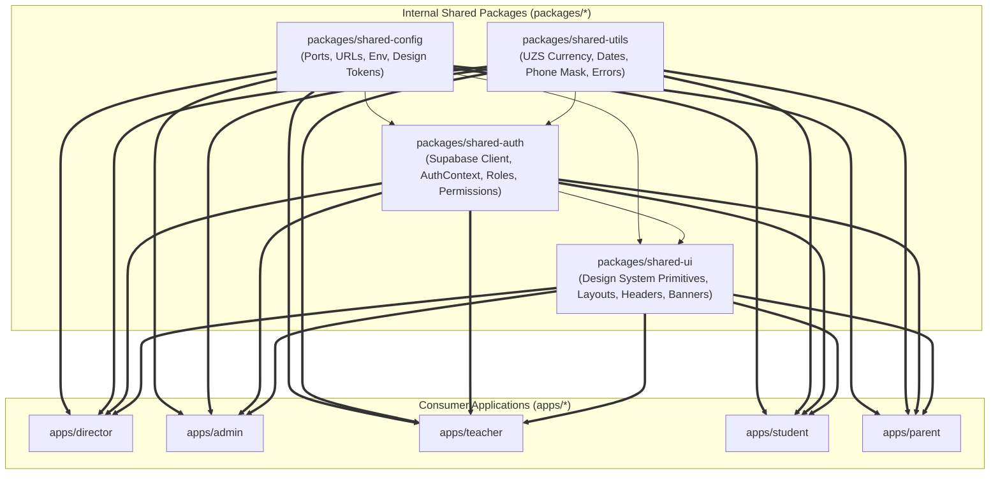

# Shared Packages Architecture

## 1. Monorepo Package Topology

The Education Center ERP + CRM organizes common code into four focused internal packages managed via **npm Workspaces**:

---

## 2. Shared Packages Breakdown

### 2.1 `@education-erp/shared-config`
- **Location**: `packages/shared-config`
- **Purpose**: System-wide configuration constants, URL resolution, and styling design tokens.
- **Contents**:
  - `constants.js`: Portal IDs, default port mapping (3001–3005), theme colors, `getPortalUrl()` helper.
  - `env.js`: Environment variable reading and Supabase configuration validator (`validateSupabaseConfig`).
  - `tailwind.preset.js`: Shared Tailwind theme configuration (brand palette, portal accent colors, typography).
- **Export Mode**: Unbundled ES Modules via `main: "./src/index.js"` and `exports: { ".": "./src/index.js", "./tailwind": "./src/tailwind.preset.js" }`.
- **Prohibited Contents**: Business logic, API calls, React components, state hooks.

### 2.2 `@education-erp/shared-utils`
- **Location**: `packages/shared-utils`
- **Purpose**: Pure mathematical, formatting, validation, and error-handling utilities.
- **Contents**:
  - `currency.js`: `formatUZS(amount)` (e.g. `1,500,000 UZS`), `parseCurrency(str)`.
  - `dates.js`: `formatDate(isoString)`, `formatDateTime(isoString)`.
  - `phone.js`: `formatUzPhone(phone)` (`+998 (90) 123-45-67`), `isValidUzPhone(phone)`.
  - `validation.js`: `isValidEmail(email)`, `sanitizeString(str)`.
  - `errors.js`: `AppError` class, `formatErrorMessage(err)`, `isNetworkError(err)`.
- **Consumers**: All five portals and `@education-erp/shared-auth`.
- **Prohibited Contents**: DOM manipulations, JSX components, external state libraries.

### 2.3 `@education-erp/shared-auth`
- **Location**: `packages/shared-auth`
- **Purpose**: Unified authentication client, session persistence, role constants, and permission checks.
- **Contents**:
  - `client.js`: Singleton `getSupabaseClient()` with production cross-subdomain cookie storage adapter (`.example.uz`) and local development fallback.
  - `AuthContext.jsx`: React `AuthContext` and `AuthProvider` scaffolding.
  - `roles.js`: `ROLES` constants, `ROLE_PORTAL_MAP`, `isValidRole()`, `canAccessPortal()`.
  - `permissions.js`: Fine-grained capability tokens (`PERMISSIONS`), role-to-permission mapping, and `hasPermission()` check.
- **Dependencies**: `@education-erp/shared-config`, `@education-erp/shared-utils`, `@supabase/supabase-js`, `react`.
- **Prohibited Contents**: Portal-specific route components, UI forms, administrative management logic.

### 2.4 `@education-erp/shared-ui`
- **Location**: `packages/shared-ui`
- **Purpose**: Reusable UI component library implementing the project's Tailwind design system.
- **Contents**:
  - `Button.jsx`: Multi-variant, accessible button component.
  - `Card.jsx`: Standard container card with optional header, subtitle, action, and footer.
  - `Input.jsx`: Standard text/email/number input with validation error states and helper labels.
  - `Badge.jsx`: Status indicators (primary, success, warning, danger, neutral).
  - `StatusBanner.jsx`: Top environmental and portal state banner.
  - `PortalHeader.jsx`: Shared navigation bar with SPA `<Link>` routing.
  - `PortalLayout.jsx`: Complete shell layout combining banner, header, main container, and footer.
  - `NotFoundView.jsx`: Unified 404 page view with return links.
  - `theme.css`: Tailwind directives (`@tailwind base; @tailwind components; @tailwind utilities;`).
- **Dependencies**: `@education-erp/shared-config`, `@education-erp/shared-auth`, `react`, `react-dom`, `react-router-dom`, `lucide-react`.
- **Prohibited Contents**: Domain-specific business widgets (e.g. Lead Kanban board or Cashier checkout form).

---

## 3. Package Dependency Rules & Guardrails

1. **Acyclic Dependency Flow**: Dependencies flow strictly downward.
   `apps/*` -> `shared-ui` -> `shared-auth` -> `shared-utils` / `shared-config`.
   No shared package may ever import from an `apps/*` directory.
2. **Raw ESM Consumption (Zero Build Step)**:
   Shared packages declare `"main": "./src/index.js"` and `"module": "./src/index.js"`. Vite resolves the source files directly via symlinks, enabling instant HMR across the entire monorepo without separate compilation steps.
3. **Strict Separation of Concerns**:
   If a component contains domain-specific knowledge (e.g., knows about student tuition ledgers or lesson grades), it **belongs in the portal application**, not in `shared-ui`.
