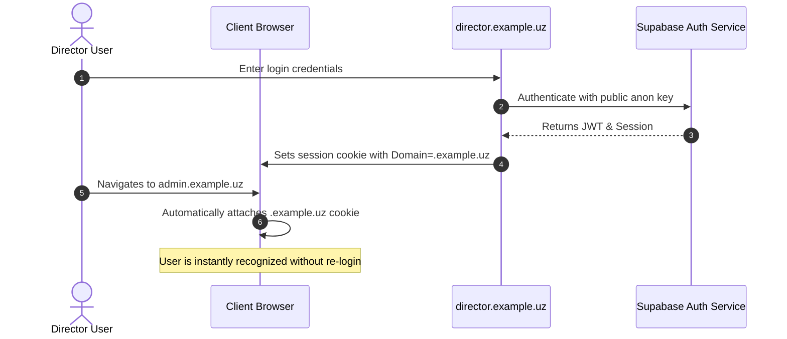

# Subdomain Architecture & Routing Strategy

## 1. Domain & Subdomain Mapping

The platform uses a dedicated subdomain routing strategy to isolate application contexts, optimize CDN caching, and enforce clean role segregation:

| Portal Application | Target Production Subdomain | Local Development URL | Primary Audience |
| :--- | :--- | :--- | :--- |
| **Director Portal** | `https://director.example.uz` | `http://localhost:3001` | Executive Leadership & Owners |
| **Admin Portal** | `https://admin.example.uz` | `http://localhost:3002` | Campus Ops, Admissions, Cashiers |
| **Teacher Portal** | `https://teacher.example.uz` | `http://localhost:3003` | Instructional Faculty & Mentors |
| **Student Portal** | `https://student.example.uz` | `http://localhost:3004` | Enrolled Learners |
| **Parent Portal** | `https://parent.example.uz` | `http://localhost:3005` | Parents & Legal Guardians |

*Note: `example.uz` serves as the architectural placeholder domain.*

---

## 2. Cross-Subdomain Session & Single Sign-On (SSO)

When a user logs in, they receive an authenticated Supabase session. To prevent repeated logins when navigating between authorized subdomains (for example, a Director accessing the Admin Portal), the system is configured as follows:

### Production Cookie Configuration
In production environments:
- **Domain**: `.${BASE_DOMAIN}` (e.g., `.example.uz`).
- **Path**: `/`
- **SameSite**: `Lax`
- **Secure**: `true` (HTTPS only)

### Local Development Fallback
During local development (`localhost`):
- Browsers disallow setting top-level domain cookies for `localhost`.
- The Supabase client factory in `@education-erp/shared-auth` automatically detects `localhost` and falls back to standard `localStorage` per port without throwing security exceptions.

---

## 3. Subdomain Redirection & Boundary Handling

1. **Role Mismatch Redirection**:
   - If a Student logs in on `admin.example.uz`, the client reads the authenticated role from `public.user_roles`.
   - The application detects that `student` is not permitted in the Admin Portal and immediately redirects the user to `https://student.example.uz`.
2. **DNS & Edge Hosting Configuration**:
   - In production, each subdomain maps to its respective built static directory (`apps/<portal>/dist`).
   - Standard rewrite rules (`/* -> /index.html`) are configured for Single Page Application (SPA) routing.
