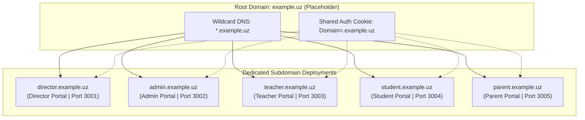
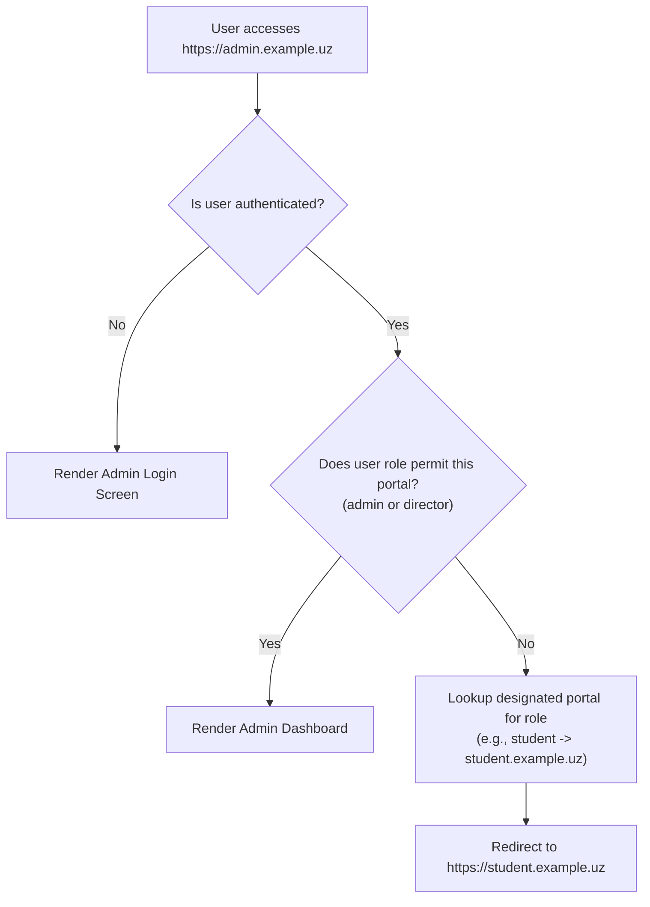

# Subdomain Architecture & Routing Strategy

## 1. Domain & Subdomain Mapping Topology

The Education Center ERP + CRM platform separates operational contexts by hosting each of the five portals on its own dedicated subdomain:



| Portal Application | Target Production Subdomain | Local Development URL | Primary Audience |
| :--- | :--- | :--- | :--- |
| **Director Portal** | `https://director.example.uz` | `http://localhost:3001` | Center Owners & Executive Leadership |
| **Admin Portal** | `https://admin.example.uz` | `http://localhost:3002` | Front-Desk, Operations & Cashiers |
| **Teacher Portal** | `https://teacher.example.uz` | `http://localhost:3003` | Instructional Faculty & Mentors |
| **Student Portal** | `https://student.example.uz` | `http://localhost:3004` | Enrolled Students & Learners |
| **Parent Portal** | `https://parent.example.uz` | `http://localhost:3005` | Parents & Legal Guardians |

*Note: `example.uz` serves as the architectural placeholder domain.*

---

## 2. Cross-Subdomain Session & Single Sign-On (SSO) Sequence

When a user signs in, they receive an authenticated Supabase session. To prevent repeated logins when navigating between authorized subdomains (for example, a Director accessing the Admin Portal), the system is configured as follows:

```mermaid
sequenceDiagram
    autonumber
    actor User as Director User
    participant Browser as Client Browser
    participant DirApp as director.example.uz
    participant SupaAuth as Supabase Auth Service
    participant AdminApp as admin.example.uz

    User->>DirApp: Enter login credentials
    DirApp->>SupaAuth: Authenticate with public anon key
    SupaAuth-->>DirApp: Returns JWT & Session
    DirApp->>Browser: Sets session cookie with Domain=.example.uz; Path=/; Secure; SameSite=Lax
    Note over Browser: Cookie is now accessible to all *.example.uz subdomains

    User->>Browser: Clicks "Switch to Admin Portal" (navigates to admin.example.uz)
    Browser->>AdminApp: HTTP Request with Cookie (contains Supabase session)
    AdminApp->>AdminApp: Initializes Supabase client from cookie session
    AdminApp->>AdminApp: Checks JWT: role = 'director' (authorized for Admin)
    AdminApp-->>User: Renders Admin Portal immediately without re-authentication!
```

---

## 3. Subdomain Role Mismatch & Automatic Redirection

To maintain strict domain boundaries, each portal's application shell validates the authenticated user's role on startup:



### Architectural Benefits:
1. **User Convenience**: A student who accidentally bookmarks `admin.example.uz` is seamlessly routed to `student.example.uz`.
2. **Defensive Posture**: Even if a user attempts to view another portal's UI, the client immediately bounces them, while backend PostgreSQL RLS guarantees zero unauthorized data exposure.
