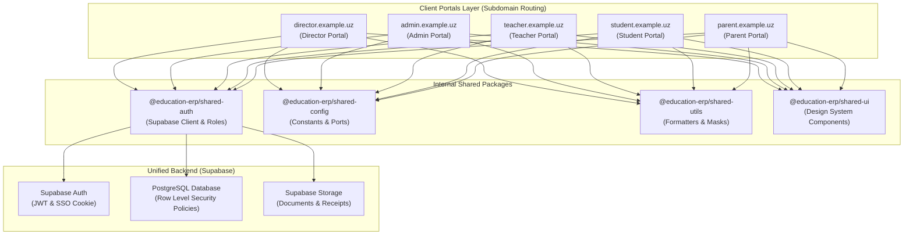

# System Architecture: Education Center ERP + CRM

## 1. High-Level Architecture Overview

The platform uses a **domain-segregated multi-portal architecture** managed as an npm Workspaces monorepo. All client applications communicate with a unified Supabase (PostgreSQL) backend.

---

## 2. Architectural Pillars

### 2.1 Independent Applications
Rather than bundling all user roles into a single bloated single-page application with risky client-side `v-if` / `{role === 'admin'}` guards, each portal is an **independent React application** (`apps/director`, `apps/admin`, `apps/teacher`, `apps/student`, `apps/parent`).
- Each application has its own `package.json`, `vite.config.js`, `index.html`, and entry point (`src/main.jsx`).
- An issue or breaking change in the Parent Portal does not affect the Director or Admin Portals.
- Production bundles contain only the code required for that specific role, keeping bundle sizes under 170 KB uncompressed.

### 2.2 Shared Packages via Unbundled ESM
Shared functionality is organized into four discrete packages under `packages/`:
- `packages/shared-auth`: Centralized Supabase client factory and role permission logic.
- `packages/shared-config`: Shared constants, route mapping, and Tailwind theme presets.
- `packages/shared-ui`: Atomic UI components, headers, layouts, and status banners.
- `packages/shared-utils`: Pure formatters for UZS currency, dates, and phone numbers.

Shared packages point directly to raw ES modules (`./src/index.js`), eliminating internal compile/build steps and delivering instantaneous Hot Module Replacement (HMR) across all apps during development.

### 2.3 Shared Backend & RLS Security Model
All five portals connect to a **single Supabase PostgreSQL database**:
- There are no separate backends or microservices for each portal.
- Authentication is unified through Supabase Auth.
- Authorization is strictly enforced inside PostgreSQL via **Row Level Security (RLS)** policies based on `auth.uid()` and the user's role stored in `public.user_roles`.
- Even if a student intercepts or attempts to call an admin API endpoint using their client token, PostgreSQL RLS drops the query immediately.
