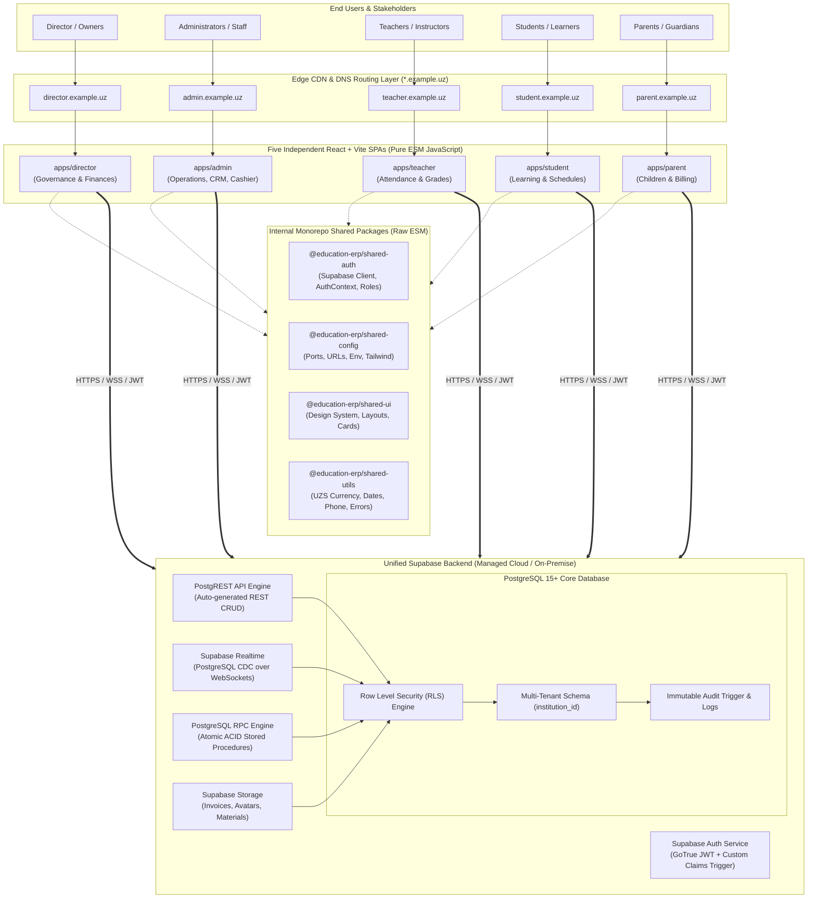
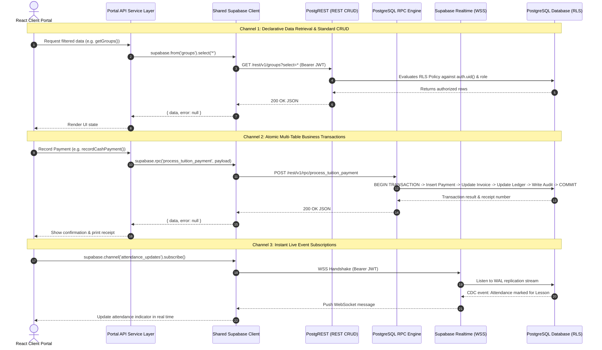

# System Architecture: Education Center ERP + CRM

## 1. Executive Architecture Summary

The **Education Center ERP + CRM** is architected as a **Domain-Segregated Multi-Portal Ecosystem** managed within an npm Workspaces monorepo. It couples five independent client single-page applications (SPAs) with a single, highly-optimized, centralized Supabase PostgreSQL backend.

Each user persona interacts with an application tailored strictly to their operational domain, hosted on an isolated subdomain:
- **Director**: `director.example.uz` (Port 3001)
- **Admin**: `admin.example.uz` (Port 3002)
- **Teacher**: `teacher.example.uz` (Port 3003)
- **Student**: `student.example.uz` (Port 3004)
- **Parent**: `parent.example.uz` (Port 3005)

All portals share unified internal packages (`packages/shared-*`), unified authentication identities, and a single relational database enforcing multi-tenancy and data authorization through PostgreSQL Row Level Security (RLS).

---

## 2. End-to-End System Topology

---

## 3. Core Architectural Principles

### 3.1 Strict Subdomain & Codebase Segregation
Unlike traditional monolithic SPAs that ship administrative, financial, instructional, and learner code in a single bundle gated by frontend conditionals, this system builds and deploys five discrete bundles. 
- Administrative financial oversight code is never compiled into the Student or Parent bundles.
- A vulnerability or bundle regression in the Parent portal cannot break Admin cashiering or Teacher attendance journaling.

### 3.2 Single Source of Truth Backend
No microservice sprawl. All five portals connect to a single Supabase backend. When an administrator records a tuition payment, the student's balance updates immediately, the parent's invoice transitions to "Paid", and the director's revenue KPI reflects the cash intake instantaneously.

### 3.3 Database-Enforced Security (RLS)
The client frontend is treated as an untrusted presentation layer. All data read, write, update, and delete permissions are validated inside PostgreSQL via Row Level Security (RLS) policies. Even if a user alters client state or issues raw HTTP requests with their JWT, PostgreSQL rejects unauthorized operations.

### 3.4 Pure ECMAScript Modules (ESM) JavaScript
The entire platform is built with standard modern JavaScript (ESM) without TypeScript compilers or complex transpilation. Shared packages expose raw ESM source (`./src/index.js`), enabling sub-150ms Hot Module Replacement across all applications during local development.

---

## 4. Main Data Flow Architecture

The platform standardizes all client-to-backend communication into three distinct channels:

---

## 5. Architectural Communication Contract

| Channel | Protocol | Tech Component | Usage Scope |
| :--- | :--- | :--- | :--- |
| **Declarative Queries** | HTTPS (REST) | PostgREST Engine | Roster lookups, schedules, profiles, catalog listings. Filtered and joined via Supabase query builder. |
| **Transactional Operations** | HTTPS (RPC) | PostgreSQL Stored Procedures | Multi-table ACID operations: tuition cashiering, student cohort enrollment, tariff reassignment, audit writes. |
| **Realtime Updates** | WSS (WebSockets) | Supabase Realtime | Lesson attendance verification, room schedule changes, urgent institutional announcements. |
| **Media & Documents** | HTTPS (Blob) | Supabase Storage | Student profile avatars, tuition payment receipts (PDF), course syllabi. |

---

## 6. Multi-Tenancy & Scalability Strategy

- **Tenant Key**: All entity tables include `institution_id` (UUID) as a non-nullable foreign key referencing `public.institutions`.
- **Branch Scope**: Campus-level tables (rooms, groups, attendance) include `branch_id` (UUID) referencing `public.branches`.
- **RLS Tenancy Enforcement**:
  Every RLS policy begins with a tenant verification check:
  `institution_id = (auth.jwt() -> 'app_metadata' ->> 'institution_id')::uuid`.
  This guarantees that even in multi-branch setups, data isolation is enforced at the database kernel level with near-zero performance overhead.

---

## 7. Consolidated Data Ownership Models

To ensure strict data boundaries across the five portals, entity ownership is structured into explicit domains:

1. **User Identity & Profiles (1:1 with auth.users)**:
   - `public.profiles` is linked 1:1 with `auth.users.id`.
   - Users possess exactly one active profile, with role membership defined in `public.user_roles`.
2. **Academic Cohorts (Owned by Institution & Branch)**:
   - Groups (`public.groups`) are created by Administrators, linked to an approved Course and Branch, and assigned exactly one primary Teacher (`teacher_id`).
   - Students link to groups through the `public.group_students` enrollment junction.
3. **Instructional Records (Linked to Lesson & Instructor)**:
   - Individual class sessions (`public.lessons`) belong to a group cohort.
   - Attendance (`public.attendance`) and Grades (`public.grades`) records reference a specific `lesson_id` and `student_id`. Only the assigned group teacher holds write privileges.
4. **Financial Ledgers (Linked to Student & Cashier)**:
   - Tuition Invoices (`public.invoices`) are billed to a specific student profile.
   - Payments (`public.payments`) record the settled invoice, payment method, amount, and the Administrator (`cashier_id`) who collected the funds.
5. **Family Relationships (Parent-to-Student Linkage)**:
   - `public.parent_students` defines authoritative parent/guardian links to student accounts, enabling parents to monitor only their verified dependents.
