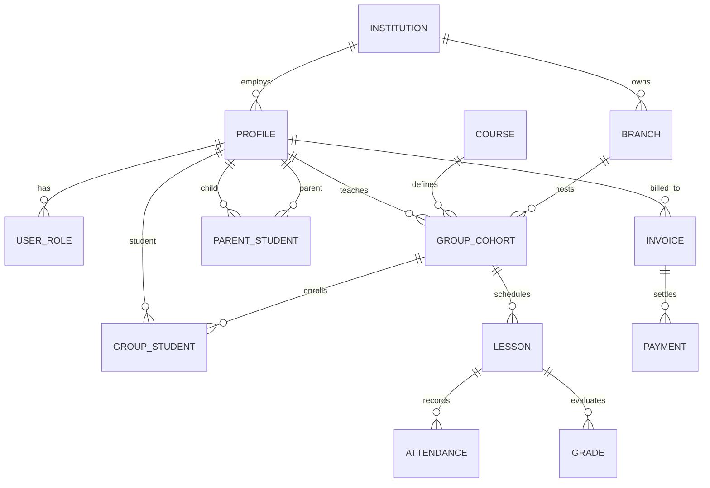

# Database Requirements & PostgreSQL Architecture

## 1. Overview

All five applications in the Education Center ERP + CRM connect to a single shared PostgreSQL database hosted on Supabase.

This document outlines the entity-relationship design, preliminary schema specifications, and Row Level Security (RLS) policies prepared for execution in Phase 02.

---

## 2. Entity-Relationship Model



---

## 3. Core Database Entities

### 3.1 Identity & Access Control
- **`public.profiles`**: Extended profile linked 1:1 with `auth.users.id`.
  - Columns: `id` (UUID, PK), `first_name` (TEXT), `last_name` (TEXT), `phone` (TEXT), `email` (TEXT), `avatar_url` (TEXT), `created_at` (TIMESTAMPTZ).
- **`public.user_roles`**: Authoritative role assignment.
  - Columns: `id` (UUID, PK), `user_id` (UUID, FK -> `profiles.id`), `role` (TEXT, CHECK `role IN ('director', 'admin', 'teacher', 'student', 'parent')`), `institution_id` (UUID), `created_at`.
  - **Constraint**: No `accountant` or `hr` role permitted.

### 3.2 Academic Structure
- **`public.institutions`**: Organization entity.
- **`public.branches`**: Campus branch entities.
- **`public.courses`**: Curriculum catalog (title, subject, duration, base price).
- **`public.groups`**: Student cohorts (course_id, branch_id, teacher_id, max_capacity, schedule_days, schedule_time).
- **`public.group_students`**: Junction table for student enrollment in cohorts.

### 3.3 Attendance & Academic Records
- **`public.lessons`**: Individual scheduled or completed class sessions.
- **`public.attendance`**: Lesson attendance record.
  - Columns: `id`, `lesson_id`, `student_id`, `status` (`present`, `absent`, `excused`, `late`), `notes`, `marked_by`.
- **`public.grades`**: Academic evaluation journal.
  - Columns: `id`, `lesson_id`, `student_id`, `grade_type` (`homework`, `quiz`, `exam`), `score`, `max_score`, `feedback`.

### 3.4 Financial Ledgers (Director & Admin Portals)
- **`public.invoices`**: Monthly tuition fee invoices.
  - Columns: `id`, `student_id`, `group_id`, `amount_due` (NUMERIC), `due_date`, `status` (`pending`, `paid`, `overdue`, `partially_paid`).
- **`public.payments`**: Payment transaction record.
  - Columns: `id`, `invoice_id`, `student_id`, `amount_paid` (NUMERIC), `payment_method` (`cash`, `card`, `bank_transfer`), `recorded_by` (FK -> `profiles.id`), `receipt_number`, `created_at`.

### 3.5 Family Relationships
- **`public.parent_students`**: Links parents to their enrolled children.
  - Columns: `id`, `parent_id` (FK -> `profiles.id`), `student_id` (FK -> `profiles.id`), `relationship_type` (`mother`, `father`, `guardian`).

---

## 4. Row Level Security (RLS) Strategy

PostgreSQL Row Level Security ensures absolute data isolation between roles:

```sql
-- Example RLS Policy: Teachers can only view attendance for groups they teach
CREATE POLICY teacher_attendance_select ON public.attendance
FOR SELECT
USING (
  EXISTS (
    SELECT 1 FROM public.lessons l
    JOIN public.groups g ON g.id = l.group_id
    WHERE l.id = attendance.lesson_id
      AND g.teacher_id = auth.uid()
  )
  OR
  EXISTS (
    SELECT 1 FROM public.user_roles ur
    WHERE ur.user_id = auth.uid()
      AND ur.role IN ('director', 'admin')
  )
);

-- Example RLS Policy: Parents can only view attendance of their linked children
CREATE POLICY parent_attendance_select ON public.attendance
FOR SELECT
USING (
  EXISTS (
    SELECT 1 FROM public.parent_students ps
    WHERE ps.parent_id = auth.uid()
      AND ps.student_id = attendance.student_id
  )
);
```

---

## 5. Security & Migration Organization for Phase 02

- Database migrations will be organized under `supabase/migrations/` using timestamped SQL files (e.g., `20261120000001_initial_schema.sql`).
- All foreign keys will enforce referential integrity (`ON DELETE RESTRICT` for financial and enrollment records).
- All financial balances will be calculated via database transactions or stored procedures to prevent race conditions.
