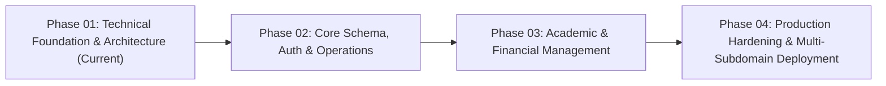

# Project Roadmap: Education Center ERP + CRM

## Phase Overview

---

## Phase 01: Foundation & Scaffolding (Current Phase)

- [x] Analyze requirements and establish system vision.
- [x] Configure npm Workspaces monorepo.
- [x] Scaffold five independent React + Vite applications (`director`, `admin`, `teacher`, `student`, `parent`).
- [x] Implement four shared packages (`shared-auth`, `shared-config`, `shared-utils`, `shared-ui`).
- [x] Establish raw ESM consumption across packages for instant Hot Module Replacement.
- [x] Implement deterministic local development ports (3001–3005).
- [x] Verify independent Vite build compilation across all five portals.
- [x] Author comprehensive documentation suite (`docs/` and root documentation).
- [x] Complete code review and verify acceptance criteria.

---

## Phase 02: Supabase Schema, Auth & Operational Core

- [ ] Execute PostgreSQL migration scripts for core entities:
  - `institutions`, `branches`, `profiles`, `user_roles`
  - `courses`, `groups`, `group_students`
  - `teachers`, `students`, `parents`, `parent_students`
- [ ] Implement Row Level Security (RLS) policies for all core tables.
- [ ] Connect `shared-auth` to active Supabase authentication:
  - Magic Link / Email & Password sign-in flows.
  - Subdomain redirection based on user role.
  - Session verification and role-based route guards.
- [ ] Implement Admin Portal operational workflows:
  - Lead intake CRM pipeline (Kanban / Table view).
  - Student registration and profile management.
  - Group creation and teacher assignment.

---

## Phase 03: Academic Journals, Grading & Financial Management

- [ ] Teacher Portal workflows:
  - Real-time lesson attendance registry.
  - Student homework submission tracking and grading journal.
- [ ] Financial Management (Director & Admin):
  - Student tuition invoicing and cashier receipt creation.
  - Monthly subscription balances and payment status.
  - Financial health reports (revenue, cash flow, outstanding debts).
- [ ] Student & Parent Portals:
  - Real-time attendance and academic progress views.
  - Child switching interface for parents with multiple enrolled students.
  - Payment invoice review and balance statements.

---

## Phase 04: Integrations, Production Deployment & Hardening

- [ ] Integration with national payment providers (Payme, Click, Uzum).
- [ ] SMS Gateway integration for attendance and payment notifications (Eskiz / PlayMobile).
- [ ] Subdomain deployment on cloud infrastructure (e.g., Cloudflare Pages / Vercel / Nginx).
- [ ] End-to-end integration testing across subdomains.
- [ ] Performance profiling and production caching strategies.
