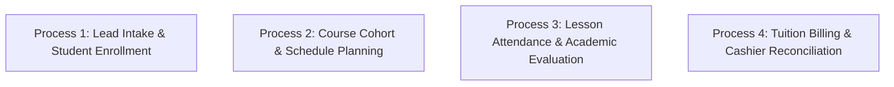

# Business Processes: Education Center ERP + CRM

## 1. Core Operational Workflows

The Education Center ERP + CRM orchestrates four critical institutional business processes:

---

## 2. Detailed Process Workflows

### 2.1 Process 1: Lead Intake to Student Enrollment

1. **Inbound Inquiry**: A prospective student or parent contacts the center (phone, walk-in, social media).
2. **Lead Creation (Admin Portal)**: Administrator logs contact details, course of interest, and source into the CRM module.
3. **Trial Lesson Scheduling**: Administrator assigns the lead to an upcoming trial lesson in an appropriate group.
4. **Trial Completion & Conversion**: Following the trial lesson, the teacher reports suitability; the administrator updates lead status to "Enrolled".
5. **Contract & Profile Finalization**:
   - Administrator registers student profile in the directory.
   - If the student is a minor, the administrator creates or links the parent account.
   - System assigns unique student identification.

### 2.2 Process 2: Course Cohort & Schedule Planning

1. **Course Definition**: Director approves curriculum, duration, and tuition tariff.
2. **Group Setup (Admin Portal)**:
   - Administrator creates group cohort (e.g., "IELTS Morning - Group 12").
   - Allocates classroom, start date, and weekly schedule (e.g., Mon/Wed/Fri 09:00 - 10:30).
   - Assigns qualified teacher.
3. **Student Enrolment**: Administrator places enrolled students into the cohort according to classroom capacity limits.
4. **Schedule Activation**: The schedule automatically propagates to the Teacher Portal, Student Portal, and Parent Portal.

### 2.3 Process 3: Lesson Attendance & Academic Evaluation

1. **Lesson Commences**: Teacher opens the assigned group journal in the Teacher Portal.
2. **Attendance Logged**: Teacher marks each student (Present, Absent, Excused, Late).
3. **Parent Transparency**: Parent Portal immediately reflects the attendance status for linked children.
4. **Homework & Quiz Grading**: Teacher records scores and individual feedback notes.
5. **Progress Summary**: Grades update the cumulative academic standing visible to Student and Parent.

### 2.4 Process 4: Tuition Billing & Cashier Reconciliation

1. **Invoice Generation**: When a student enrolls or a new monthly cycle starts, the system creates a tuition invoice based on approved course tariffs.
2. **Payment Collection (Admin Portal)**:
   - Student or parent presents payment (cash, terminal card, or bank transfer).
   - Administrator logs the payment in the Admin Cashier module.
   - Payment record is written with timestamp and admin ID.
3. **Receipt Issuance**: System generates a digital receipt; invoice status transitions to "Paid".
4. **Parent & Student Visibility**: Tuition balance updates instantly in Student and Parent portals.
5. **Executive Audit (Director Portal)**: Director reviews daily, weekly, and monthly revenue summaries, cash reconciliations, and overdue payment alerts.
