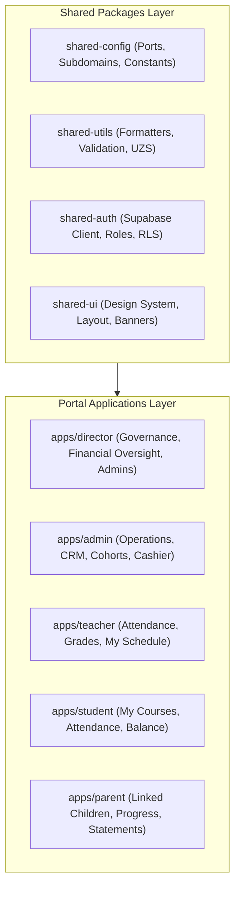

# System Modules Overview

## 1. Modular Architecture

The Education Center ERP + CRM decomposes institutional requirements into discrete, loosely-coupled modules mapped to portals and shared packages.

---

## 2. Module Specifications

### Module 1: CRM & Admissions (Admin Portal)
- **Purpose**: Lead lifecycle tracking from initial contact to enrolled student.
- **Capabilities**: Contact capture, lead stage pipeline (New, Contacted, Trial Scheduled, Enrolled, Dropped), trial lesson booking.
- **Backend Entities**: `leads`, `trial_lessons`, `students`.

### Module 2: Academic Registry & Cohort Management (Admin & Teacher Portals)
- **Purpose**: Structure classes, syllabi, and group schedules.
- **Capabilities**: Course catalog definition, group cohort creation, teacher assignment, classroom timetable mapping, student group rosters.
- **Backend Entities**: `courses`, `groups`, `group_students`, `classrooms`, `schedules`.

### Module 3: Attendance Journal (Teacher, Admin, Student, Parent Portals)
- **Purpose**: Track lesson participation and punctuality.
- **Capabilities**: Lesson session logging, multi-status attendance flags (Present, Absent, Excused, Late), attendance percentage analytics.
- **Backend Entities**: `lessons`, `attendance_records`.

### Module 4: Academic Grading & Journal (Teacher, Student, Parent Portals)
- **Purpose**: Record and communicate academic progress.
- **Capabilities**: Homework score entry, examination results, teacher commentary, GPA/mastery progression.
- **Backend Entities**: `assignments`, `grades`, `progress_reports`.

### Module 5: Tuition Billing & Cashier (Director & Admin Portals)
- **Purpose**: Student fee collection, cashiering, and institutional revenue auditing.
- **Capabilities**: Monthly tuition invoice generation, cashier payment recording (cash, card, bank transfer), receipt generation, overdue payment alerts.
- **Explicit Rule**: Operated by Admin (cashier) and Director (oversight); no separate Accountant portal.
- **Backend Entities**: `invoices`, `payments`, `tariffs`, `discounts`.

### Module 6: Family & Parent Linkage (Parent Portal)
- **Purpose**: Multi-child family management for parents.
- **Capabilities**: Link multiple student accounts to a single parent guardian profile, consolidated billing statements, child progress switching.
- **Backend Entities**: `parents`, `parent_students`.

### Module 7: Institutional Governance (Director Portal)
- **Purpose**: Campus management and administrative access control.
- **Capabilities**: Campus administrator onboarding, branch configuration, audit log inspection, institutional KPI dashboards.
- **Backend Entities**: `institutions`, `branches`, `user_roles`, `audit_logs`.
