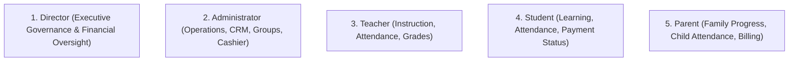

# User Roles and Permission Boundaries

## 1. System Role Definitions

The platform recognizes exactly **five** authoritative roles:

---

## 2. Detailed Role Responsibilities

### 1. Director
- **Target Portal**: `director.example.uz`
- **Scope**: Top-level institutional governance, strategic leadership, and executive financial auditing.
- **Responsibilities**:
  - Review high-level institutional metrics (gross revenue, student headcount, retention rates).
  - Provision, manage, and audit campus administrator credentials.
  - Oversee branch configurations and room allocations.
  - Approve course curriculum tariffs and institutional refund policies.
  - Full audit log inspection.

### 2. Administrator (Admin)
- **Target Portal**: `admin.example.uz`
- **Scope**: Day-to-day campus management, student admissions, and operational cashiering.
- **Responsibilities**:
  - Inbound lead management (CRM pipeline from inquiry to enrollment).
  - Student registration and parent contact linkages.
  - Course cohort (group) formation, room assignment, and schedule coordination.
  - Instructor assignment to academic groups.
  - Recording daily tuition payments, generating receipts, and managing unpaid balances.
  - **Explicit Note**: Administrators execute cashiering directly. No separate Accountant role exists.

### 3. Teacher
- **Target Portal**: `teacher.example.uz`
- **Scope**: Classroom instruction and academic record-keeping.
- **Responsibilities**:
  - View schedule and student rosters for assigned groups only.
  - Record lesson-by-lesson student attendance (Present, Absent, Excused, Late).
  - Submit academic evaluations, homework marks, and test scores.
  - Log lesson topics and classroom notes.

### 4. Student
- **Target Portal**: `student.example.uz`
- **Scope**: Personal academic participation and schedule visibility.
- **Responsibilities**:
  - View personal timetable, class locations, and teacher profiles.
  - Review personal attendance history and academic scores.
  - Check tuition payment balance and upcoming renewal dates.
  - Access course syllabi and supplementary materials.

### 5. Parent
- **Target Portal**: `parent.example.uz`
- **Scope**: Parental oversight of enrolled dependents.
- **Responsibilities**:
  - Switch between multiple linked children from a single login.
  - Monitor real-time class attendance and absence notifications.
  - Review teacher evaluations, grades, and academic feedback.
  - View itemized tuition fee statements and download payment receipts.

---

## 3. Strict Scope & Role Prohibitions

1. **NO Accountant Role**: There is **no** independent Accountant portal or role. Executive financial oversight is held by the Director, while operational cashiering is performed by the Administrator.
2. **NO Human Resources (HR) Role / Module**: Staff hiring, leave balances, and internal HR management are excluded.
3. **NO Automation Module**: Marketing automation, auto-dialers, and automated bulk messaging are excluded.

---

## 4. Role Permission Matrix

| Capability / Resource | Director | Admin | Teacher | Student | Parent |
| :--- | :---: | :---: | :---: | :---: | :---: |
| Institution Settings & Branches | **Full** | None | None | None | None |
| Administrator Management | **Full** | None | None | None | None |
| Financial Strategy & Reports | **Full** | Read | None | None | None |
| Tuition Cashiering & Receipts | None | **Full** | None | None | None |
| CRM & Admissions Pipeline | Read | **Full** | None | None | None |
| Course & Group Scheduling | Read | **Full** | None | None | None |
| Attendance Journal Entry | None | Override | **Full** | None | None |
| Grade & Evaluation Entry | None | None | **Full** | None | None |
| View Own Student Progress | None | None | None | **Full** | None |
| View Linked Children Progress | None | None | None | None | **Full** |
| Cross-Portal Access | Direct + Admin | Admin only | Teacher only | Student only | Parent only |
